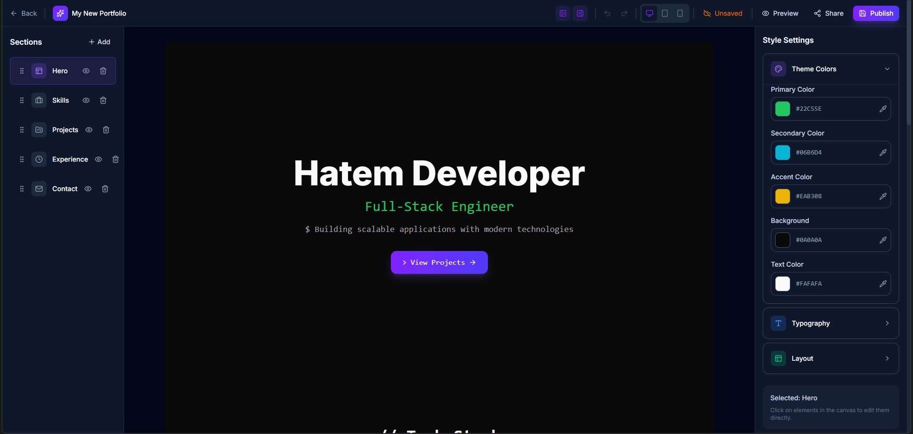
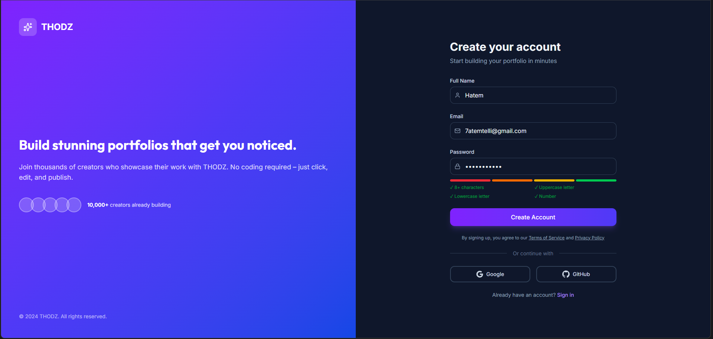
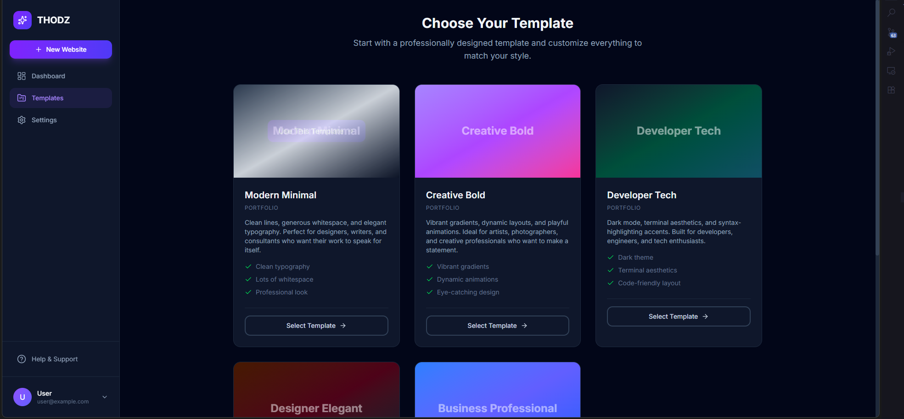

# THODZ Builder

A powerful no-code website builder that allows users to create stunning portfolio websites using customizable templates. Build your professional online presence with drag-and-drop simplicity - no coding required.

---

## 🖼️ Screenshots

<table>
<tr>
  <td align="center" valign="top" colspan="2">
    <h5>Editor - Developer Tech Template</h5>
    
  </td>
</tr>
<tr>
  <td align="center" valign="top">
    <h5>Sign Up Page</h5>
    
  </td>
  <td align="center" valign="top">
    <h5>Template Selection</h5>
    
  </td>
</tr>
</table>

---

## Features

- **Drag & Drop Editor** - Reorder sections with intuitive drag-and-drop functionality using @dnd-kit
- **Customizable Templates** - Choose from 5 professionally designed templates:
  - Modern Minimal - Clean lines and elegant typography
  - Creative Bold - Vibrant gradients and dynamic layouts
  - Developer Tech - Dark mode with terminal aesthetics
  - Designer Elegant - Sophisticated, image-focused galleries
  - Business Professional - Trust-building corporate design
- **Real-time Editing** - Click on any element to edit text, images, and styles directly
- **Full Style Control** - Customize colors, fonts, spacing, and more through the style panel
- **Section Management** - Add, remove, reorder, and toggle visibility of sections
- **Auto-save** - Changes are automatically saved as you edit
- **Responsive Preview** - Preview your site on desktop, tablet, and mobile views
- **User Authentication** - Secure login with email/password or OAuth (Google, GitHub) via Supabase
- **Publishing** - Publish your portfolio and share it with the world

---

## Tech Stack

- **Framework**: Next.js 16 with App Router
- **Language**: TypeScript
- **Styling**: Tailwind CSS 4
- **UI Components**: Custom component library with Lucide icons
- **State Management**: Zustand
- **Database**: PostgreSQL with Prisma ORM
- **Authentication**: Supabase Auth
- **Drag & Drop**: @dnd-kit/core and @dnd-kit/sortable
- **Data Fetching**: TanStack React Query

---

## Project Structure

```
src/
├── app/                    # Next.js App Router pages
│   ├── (auth)/             # Authentication pages (login, signup)
│   ├── (dashboard)/        # Dashboard layout and pages
│   ├── api/                # API routes
│   ├── auth/               # Auth callback route
│   └── editor/             # Website editor page
├── components/
│   ├── auth/               # Authentication components
│   ├── dashboard/          # Dashboard components
│   ├── editor/             # Editor components (canvas, toolbar, panels)
│   ├── sections/           # Website section components (Hero, About, etc.)
│   └── ui/                 # Reusable UI components
├── lib/
│   ├── prisma/             # Prisma client configuration
│   ├── store/              # Zustand store (editor state)
│   ├── supabase/           # Supabase client configuration
│   ├── templates/          # Template configurations
│   ├── types/              # TypeScript type definitions
│   └── utils.ts            # Utility functions
└── middleware.ts           # Auth middleware
```

---

## Getting Started

### Option 1: Docker (recommended)

The only thing you need installed is [Docker](https://docs.docker.com/get-docker/) with Compose v2.

```bash
cp .env.example .env        # add your Supabase keys
docker compose up -d --build
```

Open [http://localhost:3000](http://localhost:3000). This starts Postgres and applies the database migrations. Then the app starts.

Useful commands:

```bash
docker compose logs -f app            # follow app logs
docker compose down                   # stop (data is kept in the db-data volume)
docker compose down -v                # stop and delete all data
```

**Development with hot reload** (Node isn't needed on the host either):

```bash
docker compose -f docker-compose.dev.yml up
```

---

### Option 2: Local Node.js

Prerequisites: Node.js 20+, a PostgreSQL database, and a Supabase project (for authentication).

```bash
cp .env.example .env        # set DATABASE_URL, DATABASE_SSL and Supabase keys
npm install
npx prisma generate
npx prisma migrate deploy
npm run dev
```

---

### Environment Variables

See [`.env.example`](.env.example) for every variable and what it does.

| Variable | Description |
|----------|-------------|
| `DATABASE_URL` | Postgres connection string (set automatically in Docker) |
| `DATABASE_SSL` | `disable` (local/Docker), `require` (hosted, default), or `verify-full` |
| `NEXT_PUBLIC_SUPABASE_URL` | Supabase project URL (applied at build time) |
| `NEXT_PUBLIC_SUPABASE_ANON_KEY` | Supabase anon key (applied at build time) |

A health endpoint at `GET /api/health` returns `200` when the app can reach the database.

---

## Usage

### Creating a Website

1. Sign up or log in to your account
2. From the dashboard, click "New Website"
3. Choose a template that fits your style
4. Enter a name for your website
5. Start editing in the visual editor

---

### Editing Your Website

- **Edit Text**: Click on any text element to edit it inline
- **Reorder Sections**: Use the section panel on the left to drag and reorder sections
- **Style Elements**: Select a section and use the style panel on the right to customize colors, fonts, and spacing
- **Toggle Visibility**: Hide or show sections without deleting them
- **Add Sections**: Add new sections like Hero, About, Projects, Skills, Experience, or Contact
- **Preview**: Toggle between desktop, tablet, and mobile preview modes

---

### Publishing

- Click the "Publish" button in the editor toolbar to make your website live
- Share your published URL with the world

---

## Available Scripts

- `npm run dev` - Start development server
- `npm run build` - Build for production
- `npm run start` - Start production server
- `npm run lint` - Run ESLint

---

## Database Schema

The application uses the following main models:

- **User** - User accounts with subscription tiers
- **Website** - User-created websites with theme configuration
- **Page** - Pages within a website
- **Section** - Content sections within pages (Hero, About, Projects, etc.)
- **Asset** - User-uploaded images and files

---

## API Routes

- `GET/POST /api/websites` - List and create websites
- `GET/PUT/DELETE /api/websites/[id]` - Manage individual websites
- `GET/POST /api/pages` - Manage pages
- `GET/PUT/DELETE /api/sections/[id]` - Manage sections

---

## Contributing

Contributions are welcome! Please feel free to submit a Pull Request.

---

## License

This project is private and proprietary.

---

## Support

For help and support, use the Help & Support link in the dashboard sidebar.
